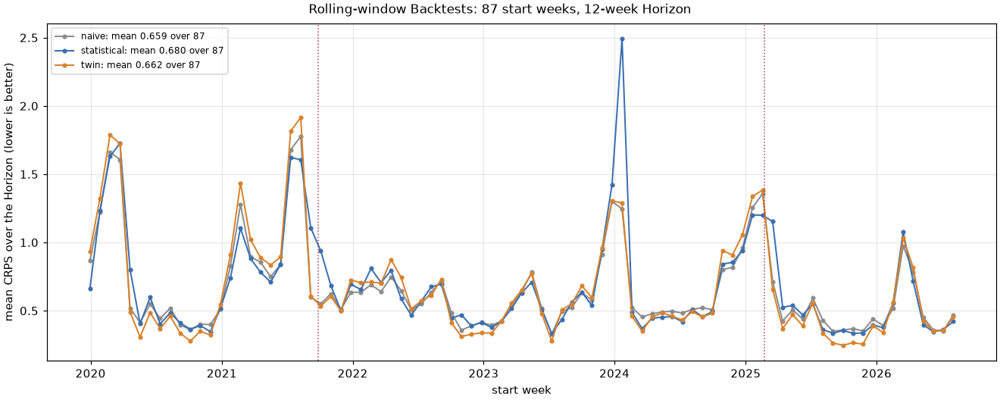

# WhatIf

[](https://github.com/HojjatKamyabi/WhatIf/actions/workflows/tests.yml)

A simulated Twin of Germany's voters that forecasts weekly national vote intention as a distribution, not a single number, and checks every forecast against what actually happened and against simple baselines.



**Over 87 Backtests since 2020, a new one every 4 weeks forecasting 12 weeks ahead, the Twin's mean CRPS was 0.662, against 0.659 for the naïve Baseline and 0.680 for the statistical one: level with the simplest forecast, and the most accurate of the three in 36 of the 87.**

Lower CRPS is better. The Twin does best in quiet periods. All three forecasts do worst in the 2021 and 2025 campaigns. The Twin's 80% intervals are still too narrow: they held the real value 70% of the time, against 87% (naïve) and 83% (statistical). None of the Twin's settings were tuned on these weeks. Run with polls up to 2026-11-03; the numbers are in [`docs/headline/summary.json`](docs/headline/summary.json).

## What it does

- **Target Outcome:** the weekly Poll Average, meaning each party's share of national vote intention averaged over all published national polls in a week. Parties: CDU/CSU, AfD, SPD, Greens, Left, BSW, FDP and Others.
- **Twin:** a Synthetic Population of Voters, built per Constituency from official election results and structural statistics. No real person is modelled. Each week, Voters drift towards the Voters they are connected to, and the Twin is measured with a simulated poll. Reactions to the economy and to recorded news Events are built, but stay off until they are calibrated.
- **Backtest:** start from a past week, run 12 weeks ahead many times, and score the spread of outcomes (the Outcome Distribution) with CRPS and 80% interval coverage. It is always compared with two Baselines: naïve ("same as last week") and statistical (a damped trend).
- **Scenarios:** dated what-ifs, such as an injected scandal or an unemployment shock, compared side by side with no intervention.
- **Honest scoring:** Voter settings may only be tuned on a Calibration Period (2017–2019). Backtests starting there are marked, and their Twin scores never count as a result. Every Backtest is reproducible from its seed.

Next (v2): language-model party agents, and the Hindsight Leak Experiment, which asks whether a language model's advantage in Backtests disappears after its training cutoff.

## Quick start

Python 3.12 or later.

```bash
pip install -e ".[dev]"
pytest                      # offline: every test runs on saved samples of the real sources
```

Download the data once into `data/`. Backtests then run offline.

```bash
whatif fetch-polls          # national polls from DAWUM
whatif fetch-elections      # federal election results and Constituency structural data
```

Run a single Backtest, or the rolling window behind the plot above. Results and plots go to `results/`.

```bash
whatif backtest --start 2024-W40
whatif rolling              # a start week every 4 weeks from 2020-W01, about 2 minutes
```

Compare two Scenarios from `scenarios.toml`. Their interventions only reach Voters when reactions are on, so this needs the economy and news data:

```bash
whatif fetch-economy
whatif fetch-events --start 2024-08-05 --end 2024-12-22
whatif fetch-attention
whatif compare --start 2024-W40 --first-guess-reactions no-intervention party-b-scandal
```

`whatif --help` lists every command.

## Data and attribution

Every source is downloaded only after its reuse terms were checked and recorded, and every download is stored with its source, licence and date. Downloads stay local; the repository holds only small samples for tests.

| Data | Licence | Attribution |
|---|---|---|
| National polls, [dawum.de](https://dawum.de) | [ODbL 1.0](https://opendatacommons.org/licenses/odbl/1-0/) | Daten von dawum.de (Open Database License (ODbL)) |
| Federal election results, the Federal Returning Officer | [Datenlizenz Deutschland – Namensnennung 2.0](https://www.govdata.de/dl-de/by-2-0) | Quelle: Die Bundeswahlleiterin, Wiesbaden; Daten als Berechnungsgrundlage verwendet |
| Constituency structural data, the Federal Returning Officer | [Datenlizenz Deutschland – Namensnennung 2.0](https://www.govdata.de/dl-de/by-2-0) | Quelle: Die Bundeswahlleiterin, Wiesbaden (Strukturdaten der Wahlkreise; Rohdaten zu Beschäftigung und Arbeitslosigkeit © Bundesagentur für Arbeit); Daten als Berechnungsgrundlage verwendet |
| Inflation and unemployment, Eurostat | [CC BY 4.0](https://eur-lex.europa.eu/eli/dec/2011/833/oj) | Source: Eurostat (prc_hicp_minr); Source: Eurostat (une_rt_m) |
| News Events, GDELT 2.0 | [GDELT terms of use](https://www.gdeltproject.org/about.html#termsofuse) | Event data: The GDELT Project (https://www.gdeltproject.org/) |
| Wikipedia page views | [CC0 1.0](https://dumps.wikimedia.org/legal.html) | Page views: Wikimedia Foundation, de.wikipedia.org (CC0) |

The polls are used under the ODbL: any database derived from them that is published stays ODbL. The election and structural data are used as a basis for calculation; WhatIf derives Voters from them and does not republish them.

## Out of scope

- Predicting seats, coalitions or who governs; the Target Outcome is national vote intention only.
- State-level or Constituency-level Poll Averages as Target Outcomes; Constituencies are used only to build the Synthetic Population.
- Simulating the economy or the news; they are recorded series that flow in.
- Media, government or individual-politician agents; only party agents (in v2).
- Modelling real individuals or using personal data.
- Any use aimed at influencing real voters: no message testing, targeting or campaign optimisation for real parties.
- A web interface; output is the command line, saved results and plots.
- Automated calibration; Voter settings are named parameters, calibrated by hand on the Calibration Period.
- Other Target Outcomes.
